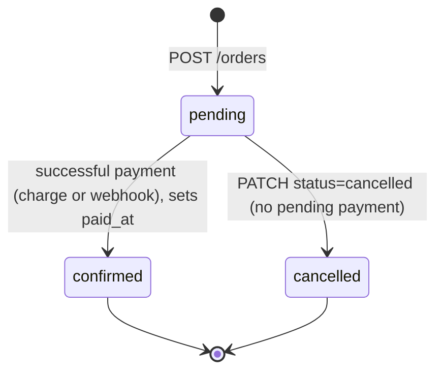
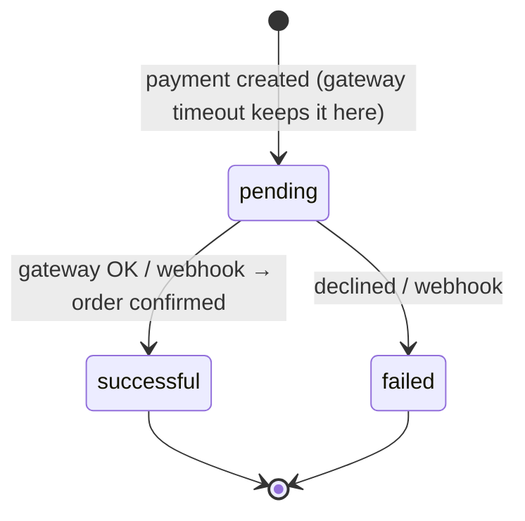

# Order Management API

A REST API for orders and payments, built on Laravel 13 with JWT authentication. Clients create orders and pay for them through pluggable payment gateways; a successful payment confirms the order. Gateway webhooks settle payments whose outcome was not known at request time.

**Start here:** [1. Setup](#1-setup) · [2. API documentation](#2-api-documentation) · [3. Running tests](#3-running-tests) · [4. Key highlights](#4-key-highlights) · [5. Decisions vs the brief](#5-decisions-vs-the-brief) · [6. How it works](#6-how-it-works)

---

## 1. Setup

**Requirements:** PHP 8.3+, Composer, MySQL 8 (Laragon works out of the box).

```bash
git clone https://github.com/ahmedessawy10/OrderManagementTask.git orderManagment
cd orderManagment
composer install
cp .env.example .env
php artisan key:generate
php artisan jwt:secret
```

Edit `.env`:

```dotenv
APP_URL=http://orderManagment.test
DB_CONNECTION=mysql            # .env.example defaults to sqlite; row locks need MySQL
DB_DATABASE=order_management
DB_USERNAME=root
DB_PASSWORD=

QUEUE_CONNECTION=sync          # OTP codes come from a queued listener; with "database" run `php artisan queue:work`
```

Then:

```bash
php artisan migrate --seed     # roles, a client user, products
php artisan serve              # http://127.0.0.1:8000/api/v1
php artisan schedule:work      # runs payments:check-pending every 5 minutes (in production: a cron entry for schedule:run)
```

**Laragon:** put the project in `C:\laragon\www\orderManagment` and start Laragon. The API is at `http://orderManagment.test/api/v1`; no `serve` needed.

**Test account (seeded):** phone `0096512345678`, password `12345678`. Outside production every OTP code is `1234`.

> The seeded user has `preferred_language = ar`, and a stored preference overrides `Accept-Language`. Call `POST /auth/set-language {"language":"en"}` to get English messages.

## 2. API documentation

The API is documented in three ways. All of them use the same folders: **Authentication**, **Products**, **Orders**, **Payments** and **Webhooks**.

| What | Where | Use it to |
|---|---|---|
| Live docs page | `GET /api/documentation` | Read every endpoint in the browser and try requests |
| OpenAPI file | [`docs/ApiDoc.openapi.json`](docs/ApiDoc.openapi.json) | Import into Apidog, Swagger UI, Postman or Insomnia |
| Postman collection | [`docs/order Managment_postman.zip`](docs/) | Import into Postman with ready environments |

### Try the main flow in 5 steps

1. Auth → **login** (`0096512345678` / `12345678`). Use the returned `token` as the Bearer token for the protected requests.
2. **List products** to pick ids → Orders → **Create Order** with `{"items":[{"product_id":1,"quantity":1}]}`. Note `data.id`.
3. Payments → **Process Payment** for that order (`:order_id`) with `{"payment_method":"credit_card"}` → **201**, and the order becomes `confirmed`. Send it again to see the **409**.
4. Set `CREDIT_CARD_SIMULATE=timeout` (then `php artisan config:clear`), create another order and pay it → **202**, and the payment stays `pending`.
5. Webhooks → `:gateway` = `credit_card`, with the body `{"reference":"<data.reference>","status":"successful","amount":"<data.amount>","currency":"KWD"}` → **200**, and the order becomes `confirmed`. Sending it again changes nothing.

### Live docs page (`cofa/laravel-api-docs`)

The package builds the documentation from the code itself: the routes, the Form Requests (validation rules become the request parameters), the API Resources (the response shapes) and the auth middleware.

- **Page:** <http://127.0.0.1:8000/api/documentation> with `php artisan serve`, or <http://orderManagment.test/api/documentation> on Laragon.
- **Raw OpenAPI JSON:** `GET /api/documentation.json`, the same spec as JSON for tools that read a URL.
- The page lists each endpoint with its parameters, example responses and code samples, and has a *Try it* panel. For protected endpoints, log in first and paste the `token` as the Bearer token.

Regenerate the spec after changing routes, requests or resources:

```bash
php artisan api-docs:generate --no-views   # refresh the spec only (keeps any customised page templates)
php artisan api-docs:history               # what changed between generations (added / changed endpoints)
php artisan api-docs:export storage/app/openapi.yaml --format=yaml   # export the spec to a file
```

### OpenAPI file

A hand-checked OpenAPI 3 file with request and response examples for every endpoint, grouped into folders through `tags` (plus `x-apifox-folder` for Apidog).

- **Apidog:** *Import → OpenAPI/Swagger →* choose the file, and keep folders from tags. Set the environment base URL to `http://127.0.0.1:8000`; the paths already start with `/api/v1`.
- **Swagger UI / Insomnia / Postman:** import the file the same way.

### Postman collection

Unzip it. It holds:

- `order Managment.postman.json`: the collection, with the folders **V1 → Client → Auth / List (products)**, **Orders**, **Payments** and **Webhooks**, each request with an example response.
- Three environments, each setting `baseUrl` (the paths already include `/api/v1`):
  - `Develop Env`: `http://127.0.0.1:8000`
  - `Testing Env` and `Prod Env`: placeholder URLs; change them to your servers.

**Import:** in Postman choose *Import*, drop the collection and the environment files, then select **Develop Env**.

## 3. Running tests

**86 tests, 329 assertions, all passing.**

```bash
php artisan test                       # or: composer test
php artisan test --filter=Webhook      # a subset
vendor/bin/pint --test                 # code style
```

The tests run on in-memory SQLite with the payment env values from `phpunit.xml`:

- `tests/Feature/Order`: CRUD, validation, ownership, status rules
- `tests/Feature/Payment`: payment outcomes, conflicts, webhooks and the scheduled pending check
- `tests/Unit/Payment`: the simulated gateways
- `tests/Feature/*`: JWT auth, registration validation, products, protected endpoints

SQLite ignores `SELECT ... FOR UPDATE`, so the tests cover the rules but not real lock contention.

## 4. Key highlights

| # | Highlight | Why it matters | Details |
|---|---|---|---|
| 1 | **No double charge** | The order row is locked (`FOR UPDATE`) while a payment is created, and only one `pending` payment per order is allowed. A double click or retry gets **409** and the gateway is called once. | [Payment flow](#payment-flow) |
| 2 | **Safe gateway timeouts** | The gateway is called *outside* the database transaction. A timeout keeps the payment `pending` (**202**) and never fails it, because the money may have moved. | [Payment flow](#payment-flow) |
| 3 | **State machines** | `OrderStatus` and `PaymentStatus` enums with `canTransitionTo()`. A confirmed order can never be downgraded, and the client can only cancel, never confirm. | [Order rules](#order-rules) |
| 4 | **Idempotent webhooks** | Matched on the payment `reference`, with amount and currency checks. Duplicate and late events are 200 no-ops, applied under a row lock. | [Webhooks](#webhooks) |
| 5 | **Lost-webhook recovery** | `payments:check-pending` runs every 5 minutes, asks the gateway (`verify()`, never charges again) and settles stuck payments. After 24 hours it logs for manual review. | [Pending check](#pending-payments-check-scheduled) |
| 6 | **Strategy pattern for gateways** | `PaymentGateway` interface; `credit_card` and `paypal` included. A new gateway is **one class + one config entry**, with no `if ($method === …)` anywhere. | [Adding a gateway](#payment-gateway-extensibility) |
| 7 | **Server-side prices** | The client sends only `product_id` + `quantity`. Prices are snapshotted from the catalog, totals are computed in integer cents, money is a 2-decimal string. | [Order rules](#order-rules) |
| 8 | **Data isolation** | Every query is scoped to the JWT user; other users' orders and payments answer **404**. | [Overview](#overview) |
| 9 | **Consistent API** | One response envelope for success, business errors, validation and framework errors; correct HTTP codes (201/202/400/401/404/409/422/429); English and Arabic messages. | [Responses and errors](#response-envelope-and-error-format) |
| 10 | **Clean, simple structure** | Controller → Facade → Service → Eloquent, Form Requests for validation, API Resources for output. Pint-clean. | [Architecture](#architecture) |
| 11 | **Tested and documented** | 86 tests; live docs page, OpenAPI file and Postman collection. | [Tests](#3-running-tests) · [Docs](#2-api-documentation) |

## 5. Decisions vs the brief

These are deliberate choices, explained so they are not read as mistakes:

- **Orders are confirmed by a successful payment, so the payment endpoint accepts *pending* orders.** The brief says "pay only confirmed orders". Here, `confirmed` means "paid": the client creates an order (`pending`), pays it, and a successful payment confirms it. The client can cancel but never confirm. This avoids a confirmed-but-unpaid state.
- **Items are `{product_id, quantity}`, not "product name, quantity, price".** Taking the price from the client would let anyone set their own price. The price is snapshotted from the catalog onto the order item, and the name is read from the product in the request language.
- **The authenticated user is the customer.** There are no `customer_*` columns; the order response embeds `user`.
- **Webhooks are not signed** in this simulated setup. This is documented as the first thing a real gateway integration must add (see [Known limitations](#known-limitations-and-future-work)).

---

## 6. How it works

**Contents:** [Overview](#overview) · [Architecture](#architecture) · [Tech stack](#tech-stack) · [Authentication](#authentication) · [API overview](#api-overview) · [Responses and errors](#response-envelope-and-error-format) · [Order rules](#order-rules) · [Payment flow](#payment-flow) · [Webhooks](#webhooks) · [Pending check](#pending-payments-check-scheduled) · [Idempotency, retries & patterns](#payment-process-idempotency-retries-and-patterns) · [Adding a gateway](#payment-gateway-extensibility) · [Configuration](#configuration) · [Assumptions](#assumptions) · [Known limitations](#known-limitations-and-future-work)

## Overview

| Area | What it does |
|---|---|
| **Orders** | CRUD scoped to the JWT user. Items are `{product_id, quantity}`; the server snapshots each product's price from the catalog and computes the total; the name is read from the product in the request language. `pending → confirmed` only through a successful payment; the client can only cancel. Items can only change while the order is pending. |
| **Payments** | Pay a *pending* order with `credit_card` or `paypal`. The order row is locked, the payment gets a ULID `reference`, the gateway is called outside the transaction, and the result is applied under a payment row lock. |
| **Safety** | A payment state machine (`pending → successful | failed`). A timeout leaves the payment `pending` until the webhook (or the scheduled pending check) settles it. At most one pending payment per order, so duplicate submits get a 409. |
| **Webhooks** | Unauthenticated JSON callbacks (no signature; see [limitations](#known-limitations-and-future-work)) matched on the payment `reference`, with amount and currency checks. Duplicate and late events change nothing. |
| **Extensibility** | A gateway is a strategy class named in `config/payment.php`. Adding one takes one class and one config entry. |

Design decisions:

- **The authenticated user is the customer.** Orders have no `customer_*` columns, and the order response embeds `user` (`id`, `name`, `email`, `phone`).
- **Payments have no `user_id`.** Ownership is `payment → order → user`. Every query is scoped to `auth('api')->user()`, so other users' orders and payments answer **404**.
- **Money is a 2-decimal string everywhere** (`"59.98"`): order totals, item prices and subtotals, and payment amounts. Totals are computed in integer cents.

## Architecture

The code follows the project's existing pattern: Controller → Facade → Service → Eloquent.

```
app/
├── Http/Controllers/Api/V1/Client/
│   ├── OrderController.php        # thin: FormRequest in, Resource out, catches ValidationException
│   └── PaymentController.php
├── Http/Controllers/Api/V1/WebhookController.php
├── Http/Requests/Api/V1/Client/{Order,Payment}/   # input validation
├── Http/Resources/Api/V1/Client/{Order,OrderItem,Payment}Resource.php
├── Facades/Client/{OrderFacade,PaymentFacade}.php
├── Services/Client/
│   ├── OrderService.php           # order rules, totals, status transitions
│   └── PaymentService.php         # process(), webhook(), state changes, gateway lookup
├── Services/Payment/
│   ├── PaymentGateway.php         # strategy interface
│   ├── SimulatesGateway.php       # shared simulator: charge() + verify() (trait)
│   ├── CreditCardGateway.php
│   └── PaypalGateway.php
├── Enums/{OrderStatus,PaymentStatus}.php           # labels + canTransitionTo()
├── Exceptions/ValidationException.php              # business error with an HTTP status
├── Exceptions/GatewayTimeoutException.php
└── Models/{Order,OrderItem,Payment}.php
config/payment.php                 # currency + gateways (driver, keys, webhook secret, simulate)
```

- **Business-rule errors** throw `App\Exceptions\ValidationException($message, status: 409|422|404)`. The controllers catch it and answer with `fail($message, $status)`.
- **Framework errors** (validation, 401, 404 from `findOrFail`, 405, 429, 500) are rendered in the same envelope by `bootstrap/app.php`.
- **Tables:** `orders`, `order_items`, `payments`.

## Tech stack

- PHP 8.3+ and Laravel 13
- `php-open-source-saver/jwt-auth` (guard `api`) for access and refresh tokens
- `spatie/laravel-query-builder` for `filter[...]`, `sort` and pagination
- `spatie/laravel-permission` and `spatie/laravel-medialibrary`, already used by the auth module
- MySQL 8 (Laragon) for real use; in-memory SQLite for the test suite
- PHPUnit 12 and Laravel Pint

## Authentication

The project already had JWT auth under `/api/v1/auth`.

1. `POST /auth/register` creates the user (**201**) and sends a `registration` OTP.
2. `POST /auth/verify-otp` with `{"phone","code":"1234","type":"registration"}` returns tokens.
3. `POST /auth/login` with `{"phone","password"}` returns tokens.
   - An unverified phone or a blocked account answers **403**.
   - Wrong credentials answer **422**.
4. Send `Authorization: Bearer <token>` on protected requests.
5. `POST /auth/refresh` with `{"refresh_token"}` returns a new token pair.

Phones must match `^(00965|\+965)[0-9]{8}$`. Token lifetimes:

- Access token: `JWT_TTL`, 60 minutes by default.
- Refresh token: `JWT_REFRESH_TTL`, 14 days by default.

The tokens sit at the top level of the envelope, next to `data`:

```json
{ "status": true, "message": "Logged in successfully", "data": { "id": 1, "name": "Client User", "...": "..." },
  "token": "eyJ...", "token_type": "bearer", "expires_in": 3600, "expires_at": "2026-10-22 15:30:54",
  "refresh_token": "eyJ...", "refresh_expires_in": 1209600, "refresh_expires_at": "2026-11-05 14:30:54" }
```

## API overview

Base URL `/api/v1`. Send `Accept: application/json`. `Accept-Language: en|ar` is optional.

| Method | Path | Description | Auth |
|---|---|---|---|
| POST | `/auth/register` | Register a client (sends OTP) | – |
| POST | `/auth/verify-otp` | Verify an OTP (registration/login returns tokens) | – |
| POST | `/auth/send-otp` | Re-send an OTP | – |
| POST | `/auth/login` | Phone + password login | – |
| POST | `/auth/refresh` | New token pair | – |
| POST | `/auth/forgot-password` | Send a password-reset OTP | – |
| POST | `/auth/reset-password` | Reset the password with the OTP | – |
| GET | `/auth/profile` | Current user | JWT |
| POST | `/auth/change-password` | Change the password | JWT |
| POST | `/auth/change-profile-image` | Upload a profile image (multipart) | JWT |
| POST | `/auth/set-language` | `en` / `ar` | JWT |
| POST | `/auth/logout` | Invalidate the token | JWT |
| DELETE | `/auth/delete-account` | Soft-delete the account | JWT |
| GET | `/orders` | Own orders (`filter[status]`, `sort`, `page`, `per_page`) | JWT |
| POST | `/orders` | Create an order (`items[]` of `{product_id, quantity}`) | JWT |
| GET | `/orders/{id}` | Show an order with items, user and payments | JWT |
| PUT/PATCH | `/orders/{id}` | Replace items (pending only) and/or cancel (`status: cancelled`) | JWT |
| DELETE | `/orders/{id}` | Delete an order without payments | JWT |
| POST | `/orders/{id}/payments` | **Pay a pending order** (`payment_method`); success confirms it | JWT |
| GET | `/payments` | Own payments (`filter[status]`, `filter[order_id]`) | JWT |
| GET | `/payments/{id}` | Show a payment | JWT |
| POST | `/webhooks/{gateway}` | Gateway callback (`credit_card`, `paypal`), 60/min | none (unauthenticated) |

The project also has `GET /products` and `/notifications/*`, which are unchanged.

**Pagination:** `per_page` defaults to 15 and is capped at 100. Lists are newest first. Orders can be sorted by `id`, `created_at` or `total_amount` (prefix `-` for descending). An unknown filter or sort answers **400**.

## Response envelope and error format

```json
// success (lists add "pagination")
{
  "status": true,
  "message": "Orders retrieved successfully",
  "data": [ { "id": 5, "status": "confirmed", "total_amount": "59.98", "...": "..." } ],
  "pagination": { "current_page": 1, "last_page": 2, "per_page": 2, "total": 3 }
}

// business error
{ "status": false, "message": "This order already has a payment in progress.", "errors": null }

// validation error: "errors" is the field map, "message" is the first error
{
  "status": false,
  "message": "The quantity must be at least 1.",
  "errors": { "items.0.quantity": ["The quantity must be at least 1."] }
}
```

| Code | When |
|---|---|
| 200 / 201 | Success. **201** for a registration, a new order, or a payment with a final outcome (`successful` **or** `failed`). |
| 202 | Payment accepted, but the gateway timed out: the payment stays `pending` until the webhook. |
| 400 | Unknown `filter` / `sort`. |
| 401 | Missing, invalid or expired JWT. |
| 403 | Login with an unverified phone or a blocked account. |
| 404 | Resource missing **or not owned**; unknown webhook gateway; webhook reference with no payment yet. |
| 405 | Wrong HTTP method. |
| 409 | Order not pending (item edit), order has payments (delete), cannot cancel (paid or pending payment), already paid/confirmed, a payment is pending. |
| 422 | Validation error (including `status` other than `cancelled`), paying a cancelled order, invalid webhook payload, webhook amount/currency mismatch. |
| 429 | Throttled (webhooks). |
| 500 | Unexpected error (details only with `APP_DEBUG=true`). |

## Order rules

An order is **confirmed by a successful payment**. The client cannot set `confirmed`; it can only cancel.



Business rules at a glance:

| Action | Allowed when | Otherwise |
|---|---|---|
| Create / edit `items` | items are `{product_id, quantity}` of existing, distinct products | 422 |
| Edit `items` | order is `pending` | 409 |
| `status: cancelled` | order is `pending`, not paid, and has no `pending` payment | 409 |
| `status: confirmed` (or anything but `cancelled`) | never; only a payment confirms | 422 |
| Pay (`POST /orders/{id}/payments`) | order is `pending`, with no `pending` payment | confirmed/paid → 409 · pending payment → 409 · cancelled → 422 |
| Delete | order has no payments at all | 409 |

**Create**

```json
POST /api/v1/orders
{ "items": [ { "product_id": 1, "quantity": 1 }, { "product_id": 2, "quantity": 2 } ] }
```

- `items` is required, with 1–100 entries. Each item has exactly two keys (`array:product_id,quantity`):
  - `product_id`: required, integer, must exist in `products`, distinct within the order. Use the ids from `GET /products`.
  - `quantity`: an integer from 1 to 10000.
- Sending `price` or `product_name` in an item answers **422** ("Each item must be an object with product_id and quantity only.").
- The same product twice answers **422** on `items.N.product_id` ("increase its quantity instead"). An unknown id answers **422** too.
- **The price comes from the catalog** (`OrderService::buildOrderItems()`) and is stored as a **snapshot** on `order_items` (`product_id`, `price`, `quantity`), so a later price change in the catalog does not affect existing orders.
- **The name is not stored.** `product_name` in the response is read from the product (`Product::translatedName()`) in the request language, falling back to the first translation, so the same order shows Arabic or English names. `order_items.product_id` is a required foreign key with `restrictOnDelete`: a product that appears in any order cannot be deleted, so the name is always available.
- The server computes `total_amount` in integer cents from the snapshot prices. Any `total_amount`, `status` or `user_id` sent by the client is ignored.
- New orders are `pending`, in `PAYMENT_CURRENCY`.

The response lists each item with `product_id`, `product_name`, `quantity`, `price` and `subtotal`:

```json
{ "id": 1, "product_id": 2, "product_name": "PlayStation 5 Pro Console", "quantity": 2, "price": "249.50", "subtotal": "499.00" }
```

**Update** (PUT and PATCH behave the same, and every field is optional). The order row is locked for the whole update.

- `items` (same `{product_id, quantity}` rules as create) **replaces** all items, takes fresh price snapshots from the catalog, and recomputes the total. This only works while the order is `pending`; otherwise **409**. A pending order may already have `failed` payments; the next payment uses the new total.
- `status` accepts only `cancelled` (`validation.custom.status.in`; anything else → **422**). Re-sending `cancelled` on a cancelled order is a no-op.
- Cancelling answers **409** when the order is paid, or has a `pending` payment that could still succeed.

**Delete**

- Only orders with **no payments** can be deleted (items cascade). Otherwise **409**, which keeps payments auditable.

**Confirmed means paid.** A successful payment sets `status: confirmed` and `paid_at` together, and the resource shows `is_paid: true`. A failed payment leaves the order `pending`, so the client can pay again or cancel. `GET /orders/{id}` includes the order's `payments` (newest first).

## Payment flow

`POST /orders/{id}/payments` with `{"payment_method": "credit_card" | "paypal"}`:

```mermaid
sequenceDiagram
    autonumber
    participant C as Client
    participant P as PaymentService
    participant DB as Database
    participant G as Gateway (strategy)

    C->>P: process(orderId, method)
    rect rgb(235, 245, 255)
    note over P,DB: Transaction 1
    P->>DB: SELECT own order FOR UPDATE (404 if missing / not owned)
    P->>P: confirmed/paid? (409) · cancelled? (422) · pending payment? (409)
    P->>DB: INSERT payment (status pending, reference = ULID)
    end
    P->>G: charge(payment), outside any transaction
    alt timeout (GatewayTimeoutException)
        G-->>P: outcome unknown → payment stays pending
    else answer
        G-->>P: {status: successful | failed, gateway_reference}
    end
    rect rgb(235, 245, 255)
    note over P,DB: Transaction 2
    P->>DB: SELECT payment FOR UPDATE
    P->>DB: apply the status only if canTransitionTo() allows it, keep gateway_reference;<br/>on successful: order.status = confirmed, order.paid_at = now
    end
    P-->>C: 201 successful / 201 failed / 202 pending
```

Why it is built this way:

- **Locking the order, then creating** makes the "pending, not paid, no pending payment" checks and the insert atomic. Two simultaneous submits run one after the other. The second one sees the first payment and gets **409**, so the customer is not charged twice.
- **The reference first.** The payment row and its ULID `reference` are committed before the gateway call. The reference is what webhooks use to find the payment, even when the charge timed out.
- **The charge runs outside the transaction**, so a slow gateway never holds a database lock.
- **A timeout leaves the payment `pending`, never `failed`.** The card may have been charged, so the payment is not failed and not retried (202). It keeps blocking a new payment and cancellation until the webhook, or the scheduled pending check below, settles it.
- **The result is applied under a lock on the payment row.** The synchronous result and a webhook can arrive at the same moment, so whichever takes the lock first wins. The other one can only make transitions the state machine allows.

### Payment state machine



- There are three statuses. `successful` and `failed` are final.
- `pending` is the only **active** status. A pending payment blocks a new payment for the same order (409) and blocks cancellation.
- After a `failed` payment, the order is still `pending` and the client can pay again, which creates a new payment row.

## Webhooks

`POST /api/v1/webhooks/{gateway}` is public and throttled to 60/min. It needs no JWT and **no signature** (see the security note under [limitations](#known-limitations-and-future-work)). `PaymentService::webhook($gateway, $rawBody)` handles the raw JSON body:

```
{ "reference": "01M5J54C418VP4R9H8YKXBWFBQ", "status": "successful",
  "amount": "59.98", "currency": "KWD", "gateway_reference": "credit_card_9f2kq7x1m3n8b4v6c0z5" }
```

The checks run in this order:

1. **Gateway:** `{gateway}` must have a `driver` in `config/payment.php`; otherwise **404**.
2. **Payload:** `reference` (required), `status` (`successful` or `failed` only), `amount` (numeric), `currency` (3 letters) and `gateway_reference` (optional). Anything else answers **422** with field errors. A bad `status` answers "The webhook status must be successful or failed."
3. **Lookup:** the payment is found by `(method = gateway, reference)` with `FOR UPDATE`. If none is found, the answer is **404**: the webhook may have arrived before the payment was committed, and the gateway will retry.
4. **Amount and currency** must equal the payment's; otherwise **422** and the mismatch is logged.
5. **Apply:** the status changes only if `canTransitionTo()` allows it, which means only from `pending`.
   - On `successful`, the order becomes `confirmed` and `paid_at` is set.
   - On `failed`, the order stays `pending`.

The answer is **200** with the payment. **Duplicate and late events** are also 200, but they are no-ops because of the status check under the lock:

- A second `successful` changes nothing.
- A `failed` arriving after `successful` changes nothing, so a confirmed order is never downgraded.

## Pending payments check (scheduled)

A webhook can be lost. Without a fallback, a `pending` payment would block its order forever, so `php artisan payments:check-pending` runs **every 5 minutes** (`withSchedule()` in `bootstrap/app.php`, `withoutOverlapping`):

1. It picks payments that are still `pending` and older than `PAYMENT_PENDING_CHECK_AFTER_MINUTES` (10). The delay gives the webhook time to arrive first.
2. For each one it calls `gateway->verify($payment)`. This **only asks** the gateway about our `reference` and **never charges again**.
3. The answer goes through the same locked `applyStatus()` as the charge result and the webhook:
   - `successful` → the payment is successful and the order is confirmed with `paid_at`;
   - `failed` → the payment failed and the order stays `pending`, so the customer can pay again;
   - no answer (timeout) or still pending → the payment **stays `pending`** and the next run retries.
4. If a payment is still `pending` after `PAYMENT_PENDING_ALERT_AFTER_HOURS` (24), it **stays pending** (it is never failed automatically, because the money may have moved) and a warning `Payment still pending, needs manual review.` is logged for a person to check.

One failing payment (for example, its gateway was removed from the config) is logged and does not stop the others.

## Payment process, idempotency, retries and patterns

This section pulls together how the payment code stays correct when requests repeat, run at the same time, or lose their answer.

### The payment process in short

| Step | Where (`app/Services/Client/PaymentService.php`) | What happens |
|---|---|---|
| 1. Lock and check | `process()` → `validateOrderCanBePaid()` | `SELECT … FOR UPDATE` on the user's order. It must be `pending`, not paid, and have no `pending` payment. |
| 2. Create | `createPayment()` | A `pending` payment with a unique ULID `reference` is committed **before** any gateway call. |
| 3. Charge | `chargeGateway()` | The strategy's `charge()` is called **outside** the transaction. A timeout leaves the payment `pending` (202). |
| 4. Apply | `updatePaymentStatus()` → `applyStatus()` | The payment row is locked again and the status changes only if the state machine allows it. Success confirms the order and sets `paid_at`. |
| 5. Settle later | `webhook()` / `checkPending()` | A webhook or the scheduled `verify()` settles a `pending` payment through the same `applyStatus()`. |

### Idempotency: doing it twice has the same effect as once

There is no `Idempotency-Key` header. Idempotency comes from **row locks plus the payment state machine**:

| Case | How it stays safe |
|---|---|
| Double click or retry on **Pay** | The order row is locked (step 1), so the second request waits. It then finds the `pending` or `successful` payment and gets **409** without calling the gateway. One payment row, one charge. |
| Gateway **timeout** | The payment stays `pending` and is **never charged again automatically**. A new pay request gets 409 until it is settled. |
| **Duplicate webhook** | The payment is locked and `canTransitionTo()` only allows `pending → successful/failed`. A second `successful`, or a late `failed` after `successful`, is a 200 no-op, and `paid_at` keeps its first value. |
| Webhook and charge result **at the same moment** | Both lock the same payment row; the first one applies, the second sees a final status and does nothing. |
| Gateway-side duplicate charge | Each payment has its own `reference`, which a real gateway receives as its idempotency key (see the AcmePay example below). |
| Cancel twice / same status / same items | `changeStatus()` returns early for the same status; `PUT` items replaces them with the same list. |

**Not idempotent:** `POST /orders`. A double submit creates two `pending` orders. No money is involved, and the extra order can be cancelled or deleted.

### Retries: who retries what

| Who | When | How it is kept safe |
|---|---|---|
| **The client** | After a `failed` payment | A failed payment is final and does not block the order, so a new `POST …/payments` creates a new payment row. |
| **The client** | After a timeout (202) | Gets 409 while the payment is `pending`; it should poll `GET /orders/{id}` instead of paying again. |
| **The gateway** | Webhook for a reference we do not know yet | We answer **404** (not 200), so the gateway sends it again later. |
| **The gateway** | Webhook delivered more than once | Each repeat is a no-op (see idempotency). |
| **Our scheduler** | `payments:check-pending` every 5 minutes | It retries `verify()` for `pending` payments older than 10 minutes. It only asks, never charges, and `withoutOverlapping()` stops two runs from overlapping. After 24 hours it keeps the payment `pending` and logs it for manual review. |
| **Nobody** | A new `charge()` after a timeout | Never done automatically, because the first charge may already have taken the money. |

### Outbox pattern (not implemented; how it would fit)

**What it is:** when a database change must also trigger something outside the database, such as an email, an ERP update or a message to a queue, you write an `outbox_events` row **in the same transaction** as the change. A separate worker then reads unsent rows, publishes them and marks them sent. A crash between "payment saved" and "event sent" cannot lose the event, because the event is already in the database.

**Why it is not here:** a successful payment changes only database rows (the payment and the order), inside one transaction. Nothing leaves the database, so there is no event to lose yet.

**Where it would go:** in `applyStatus()`, in the same transaction that confirms the order:

```php
if ($to === PaymentStatus::Successful) {
    $payment->order()->update(['status' => OrderStatus::Confirmed, 'paid_at' => now()]);

    OutboxEvent::create([                       // same transaction: saved together or not at all
        'type' => 'payment.successful',
        'payload' => ['payment_id' => $payment->id, 'order_id' => $payment->order_id],
    ]);
}
```

Then a scheduled `outbox:publish` command would send unsent rows and set `published_at`. A row may be sent twice if the worker crashes after sending, so consumers must be idempotent.

### Strategy pattern

Each gateway is a **strategy** behind one interface. `PaymentService` never knows which gateway it uses:

```
PaymentService ──uses──▶ PaymentGateway (interface: charge, verify)
                              ▲                 ▲
                   CreditCardGateway      PaypalGateway      … AcmePayGateway
                         (config/payment.php: method → driver class)
```

- **Pick:** `PaymentService::gateway($method)` resolves `config("payment.gateways.$method.driver")` from the container.
- **Use:** `->charge($payment)` when paying, `->verify($payment)` in the scheduled check. There is no `if ($method === …)` anywhere.
- **Add:** one class plus one config entry; validation and the webhook route accept the new key automatically. See below.

## Payment gateway extensibility

The gateway layer uses the strategy pattern:

```php
namespace App\Services\Payment;

interface PaymentGateway
{
    /** @return array{status: PaymentStatus, gateway_reference: ?string}  Must not save the payment. */
    public function charge(Payment $payment): array;   // throw GatewayTimeoutException when the outcome is unknown

    /** Ask the gateway what happened to an earlier charge (by reference). Never charges. Used by payments:check-pending. */
    public function verify(Payment $payment): array;
}
```

The pieces fit together like this:

- `PaymentService::gateway($method)` resolves `config("payment.gateways.$method.driver")` through the container, so constructor injection works.
- `ProcessPaymentRequest` accepts any key of `config('payment.gateways')` as `payment_method`.
- The webhook route accepts any gateway that has a `driver`.
- `payments.method` is a plain string column, so no enum or migration changes are needed.
- `CreditCardGateway` and `PaypalGateway` only name their config key. The `SimulatesGateway` trait provides `charge()` (driven by `simulate`: `success` | `fail` | `timeout`), and `verify()` (driven by `simulate_verify`: `success` | `fail` | `pending` | `timeout`).

### Adding a new gateway

Example: a fictional **AcmePay** (`acme_pay`). **Two files change**, plus `.env`.

**1. The class**: `app/Services/Payment/AcmePayGateway.php`

```php
<?php

declare(strict_types=1);

namespace App\Services\Payment;

use App\Enums\PaymentStatus;
use App\Exceptions\GatewayTimeoutException;
use App\Models\Payment;
use Illuminate\Http\Client\ConnectionException;
use Illuminate\Support\Facades\Http;

final class AcmePayGateway implements PaymentGateway
{
    public function charge(Payment $payment): array
    {
        try {
            $response = Http::baseUrl(config('payment.gateways.acme_pay.base_url'))
                ->withToken(config('payment.gateways.acme_pay.secret'))
                ->timeout(10)
                ->withHeaders(['Idempotency-Key' => $payment->reference]) // the provider charges this payment once
                ->post('/charges', [
                    'merchant_reference' => $payment->reference,           // sent back in the webhook
                    'amount' => (string) $payment->amount,
                    'currency' => $payment->currency,
                ])
                ->throw();
        } catch (ConnectionException) {
            throw new GatewayTimeoutException; // outcome unknown -> payment stays "pending", settled by the webhook
        }

        return [
            'status' => $response->json('state') === 'paid' ? PaymentStatus::Successful : PaymentStatus::Failed,
            'gateway_reference' => $response->json('charge_id'),
        ];
    }

    public function verify(Payment $payment): array
    {
        try {
            $response = Http::baseUrl(config('payment.gateways.acme_pay.base_url'))
                ->withToken(config('payment.gateways.acme_pay.secret'))
                ->timeout(10)
                ->get('/charges', ['merchant_reference' => $payment->reference])
                ->throw();
        } catch (ConnectionException) {
            throw new GatewayTimeoutException; // still unknown -> stays "pending", the next run retries
        }

        return [
            'status' => match ($response->json('state')) {
                'paid' => PaymentStatus::Successful,
                'declined', 'not_found' => PaymentStatus::Failed,
                default => PaymentStatus::Pending,
            },
            'gateway_reference' => $response->json('charge_id'),
        ];
    }
}
```

**2. The config entry**: `config/payment.php`

```php
'acme_pay' => [
    'driver' => \App\Services\Payment\AcmePayGateway::class,
    'base_url' => env('ACME_PAY_BASE_URL', 'https://api.acmepay.test'),
    'api_key' => env('ACME_PAY_API_KEY'),
    'secret' => env('ACME_PAY_SECRET'),
],
```

Then run `php artisan config:clear`. From that point:

- `{"payment_method": "acme_pay"}` is accepted.
- `POST /webhooks/acme_pay` works. AcmePay must send our `reference`, `status`, `amount` and `currency` in the JSON body. (A real integration should also verify AcmePay's signature; see the security note.)

For another *simulated* gateway, the class only needs `use SimulatesGateway;` and a `key()` method that returns its config key. `CreditCardGateway` is the example to copy.

## Configuration

| Key | Default | Purpose |
|---|---|---|
| `PAYMENT_CURRENCY` | `KWD` | Currency of new orders and payments |
| `CREDIT_CARD_API_KEY`, `CREDIT_CARD_SECRET` | – | Gateway credentials (unused by the simulator) |
| `CREDIT_CARD_SIMULATE` | `success` | `success` → 201 successful · `fail` → 201 failed · `timeout` → 202, payment stays pending |
| `CREDIT_CARD_SIMULATE_VERIFY` | `success` | What the pending check hears from the gateway: `success` · `fail` · `pending` · `timeout` |
| `PAYPAL_API_KEY`, `PAYPAL_SECRET`, `PAYPAL_SIMULATE`, `PAYPAL_SIMULATE_VERIFY` | as above | The same settings for `paypal` |
| `PAYMENT_PENDING_CHECK_AFTER_MINUTES` | `10` | A pending payment is verified with its gateway only after this age |
| `PAYMENT_PENDING_ALERT_AFTER_HOURS` | `24` | Still pending after this age → stays pending and a warning is logged |
| `JWT_SECRET`, `JWT_TTL`, `JWT_REFRESH_TTL` | – / 60 / 20160 | JWT signing and token lifetimes (minutes) |
| `QUEUE_CONNECTION` | `database` | OTP listener queue. Use `sync` locally, or run a worker. |

These map to `config/payment.php`: `currency`, `pending.{check_after_minutes, alert_after_hours}`, plus `gateways.<key>.{driver, api_key, secret, simulate, simulate_verify}`. Run `php artisan config:clear` after changing `.env` if the config is cached.

## Assumptions

- The whole app uses one currency (`PAYMENT_CURRENCY`). Amounts are `decimal(10,2)`.
- **Items reference catalog products, and the price comes from the server, not the client.** The brief listed "product name, quantity, price"; we take `product_id` + `quantity`, snapshot the price on the order item and read the (translated) name from the product.
- A single successful payment pays an order in full. There are no partial payments.
- No card data passes through the API. The client only picks `payment_method`.
- **Orders are confirmed by a successful payment, so the payment endpoint accepts pending orders.** This intentionally replaces the brief's "pay only confirmed orders" with "confirmed only by payment". The client can cancel but never confirm.
- Webhooks report only final outcomes (`successful` / `failed`) and carry our `reference`.
- Hiding other users' resources behind 404 is preferred over 403.

## Known limitations and future work

- **Pending payments are settled by the webhook or the scheduled check.** A payment that neither can settle stays `pending` (never failed automatically) and is logged after 24 hours for manual review; until then it blocks a new payment and cancellation for that order. A gateway exception other than a timeout returns 500 and also leaves the payment `pending`, for the scheduled check to pick up. The scheduler must be running (`schedule:work` or a cron entry for `schedule:run`).
- **No `Idempotency-Key`.** A double submit is prevented by the order row lock plus the one-active-payment rule; the second request gets 409. A client retry after a lost response therefore gets 409 (or "already paid") instead of the original response, and it should read `GET /orders/{id}` (which includes the payments).
- **No outbox:** side effects such as emails or fulfilment would need a transactional outbox, so they are not lost or duplicated.
- **No refunds** or partially refunded states.
- **Simulated gateways:** `credit_card` and `paypal` only simulate outcomes. Real SDKs, 3-D Secure and redirect flows are not implemented.
- **Lock behaviour needs MySQL to test.** SQLite ignores `FOR UPDATE`. The concurrency guarantees hold on MySQL InnoDB, but proving them needs parallel requests against MySQL.
- **Security: webhooks are not authenticated.** There is no signature check and no IP allow-list. Anyone who knows a payment `reference` (it is returned to the client in the payment response) and its amount could mark that `pending` payment `successful`, which confirms the order without real payment. Replays are harmless only because of the state machine. A real gateway integration **must** verify the provider's signature (for example HMAC over the raw body) or allow-list the provider's IPs before applying any event.
